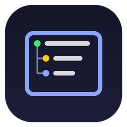
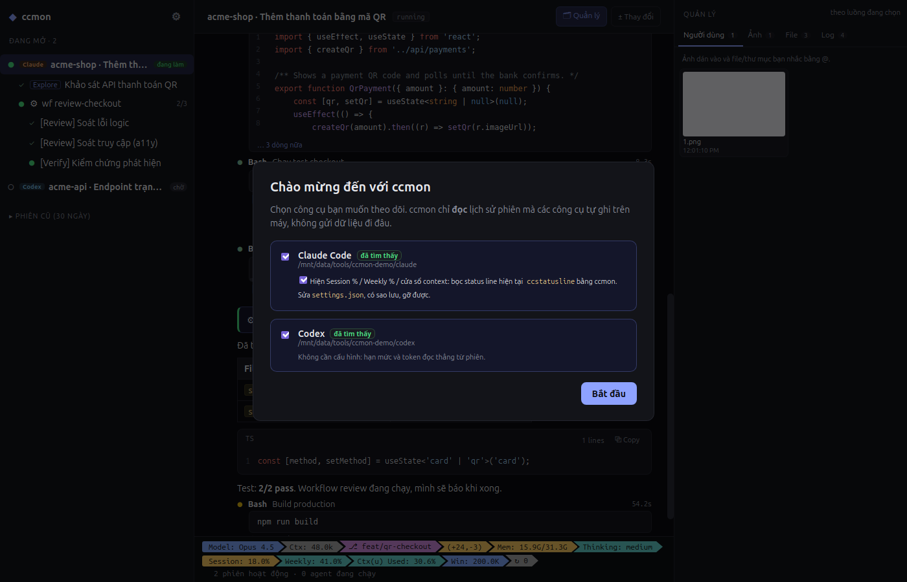

<div align="center">



# ccmon

**See what your AI coding agent is doing — live.**

A free, open-source desktop app that turns **Claude Code** and **Codex** sessions into a clean,
real-time view: every prompt, command, file edit, sub-agent and workflow, with side-by-side diffs
and plan usage. Local and read-only.

[](https://github.com/thanhson0514/cc-monitor/actions/workflows/ci.yml)
[](https://github.com/thanhson0514/cc-monitor/releases)
[](LICENSE)


[**Download**](https://github.com/thanhson0514/cc-monitor/releases/latest) ·
[Website](https://thanhson0514.github.io/cc-monitor) ·
[Report an issue](https://github.com/thanhson0514/cc-monitor/issues) ·
[Tiếng Việt](README.vi.md)


</div>

## Why

Coding agents work fast and in parallel: a main session spawns sub-agents, runs workflows, edits
files and executes commands. In a terminal that scrolls by too quickly to follow, and sub-agents are
almost invisible. ccmon reads the transcripts the agents already write on your machine and shows
everything as it happens, without changing how you work.

## Features

| | |
|---|---|
| ⚡ **Live timeline** | Prompts and answers (Markdown, code blocks with line numbers and copy), and every tool call as a readable card: Bash with its description and output, Edit as a diff, Read, Grep, Write, todos. |
| 🌳 **Sub-agents & workflows** | A tree of open sessions, sub-agents and workflow agents with live status. Open any thread to see the brief it received and the report it sent back. |
| ± **Side-by-side diffs** | Every file the session changed, compared with how it was *before the session* (from Claude Code's own backups — no git needed) or with git HEAD. |
| 🗂 **Files, images & logs** | Images you pasted, screenshots the agent took, files it read or wrote, scratchpad output and a ✓/✗ command log, with image/text previews and rendered Markdown. |
| 📊 **Plan usage** | Model, context used, 5-hour and weekly limits, effort, git branch and lines changed in a compact status bar. |
| 🧭 **Session history** | Open sessions first (with busy/idle state), then recently closed ones, then 30+ days of history grouped by project. |
| 🔒 **Local & read-only** | No account, no network calls, no telemetry. |

<table>
<tr>
<td></td>
<td></td>
</tr>
</table>

## Supported agents

| Agent | Reads | Sub-agents | Plan limits |
|---|---|---|---|
| **Claude Code** | `~/.claude/projects/**/*.jsonl` | ✓ sub-agents and workflow agents | via optional status-line wrapper |
| **Codex** | `~/.codex/sessions/**/rollout-*.jsonl` | ✓ spawned agents | ✓ built in (from `token_count`) |

On first launch ccmon detects which agents are installed and lets you pick **Claude Code**,
**Codex**, or both. Change it later from **⚙ Settings**.

> Transcript formats are internal to each tool and can change between versions. ccmon parses them
> tolerantly — unknown lines are skipped — and was verified against Claude Code 2.1 and the Codex
> VS Code extension (late 2026).

## Install

Grab the installer for your OS from the [latest release](https://github.com/thanhson0514/cc-monitor/releases/latest).

**Windows 10/11** — run `ccmon_<version>_x64-setup.exe` (or the `.msi`). It installs for your user
only (no admin needed); WebView2 is installed automatically if missing.

**Linux** — AppImage for any distro, or `.deb` for Debian/Ubuntu:

```bash
chmod +x ccmon_*_amd64.AppImage && ./ccmon_*_amd64.AppImage
# or
sudo apt install ./ccmon_*_amd64.deb
```

A terminal UI (`ccmon`) is also attached to each release (`ccmon-cli-*`).

### Plan usage for Claude Code (optional)

Claude Code only exposes 5-hour/weekly limits and the context-window size to its **status line**
command. In Settings, ccmon can wrap your existing status line as
`<ccmon> tee -- <your command>`: it saves a copy of that JSON for ccmon and passes it through
unchanged, so your status line looks exactly the same. `settings.json` is backed up, and
**Remove** restores it. Codex needs nothing — limits are in its session files.

## How it works

```
Claude Code ──writes──► ~/.claude/projects/…/<session>.jsonl  ┐
             (+ sub-agent & workflow transcripts, file backups)│   ccmon (read-only)
Codex ───────writes──► ~/.codex/sessions/…/rollout-*.jsonl     ├─► tail every 200 ms ─► thread tree ─► UI
                                                                ┘   parse tolerantly
```

- A background worker discovers sessions and tails new lines (~0.4 s end-to-end latency).
- Both formats are mapped into one event model, so the UI treats Claude Code and Codex the same.
- The live branch is reconstructed from the transcript (rewinds and `/compact` handled).

## Build from source

Requirements: Rust stable, Node.js 20+, Yarn 1, and the
[Tauri prerequisites](https://tauri.app/start/prerequisites/) for your OS.

```bash
git clone https://github.com/thanhson0514/cc-monitor && cd cc-monitor
cargo test --workspace
./gui/build.sh                       # desktop app → target/release/ccmon-gui
cargo run --release -p cc-monitor    # terminal UI
```

Try it on fake data: `python3 demo/make_demo.py /tmp/ccmon-demo` prints the environment variables
to point ccmon at a demo dataset.

## FAQ

**Is ccmon made by Anthropic or OpenAI?** No. It is an independent community project, not
affiliated with or endorsed by either company.

**Does it send my code anywhere?** No. Everything stays on your machine.

**Why can't I see the model's full thinking?** Both tools store reasoning encrypted or leave it out
of transcripts. ccmon shows what is saved: short progress notes and thinking time.

**The UI is in Vietnamese?** The first release ships a Vietnamese interface; English UI is planned
(contributions welcome).

## Contributing

Bug reports and ideas: open an [issue](https://github.com/thanhson0514/cc-monitor/issues).
Code changes: fork the repository and open a pull request — see [CONTRIBUTING.md](CONTRIBUTING.md).

## License

[MIT](LICENSE) © 2026 Lê Thanh Sơn — free to use, modify and distribute, including commercially.

Claude Code is a trademark of Anthropic. Codex is a trademark of OpenAI.
