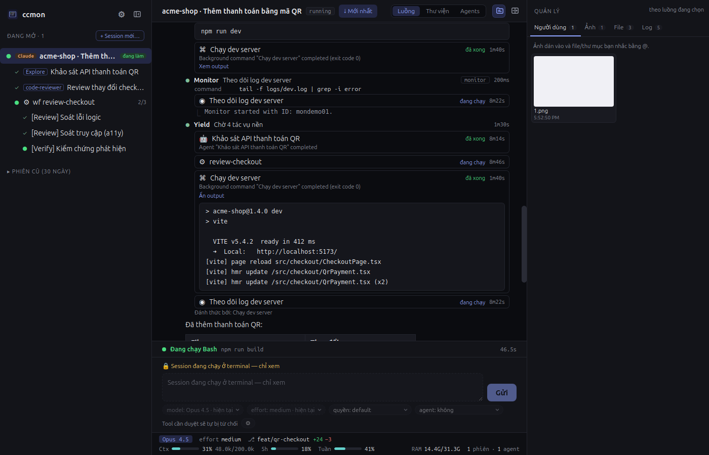
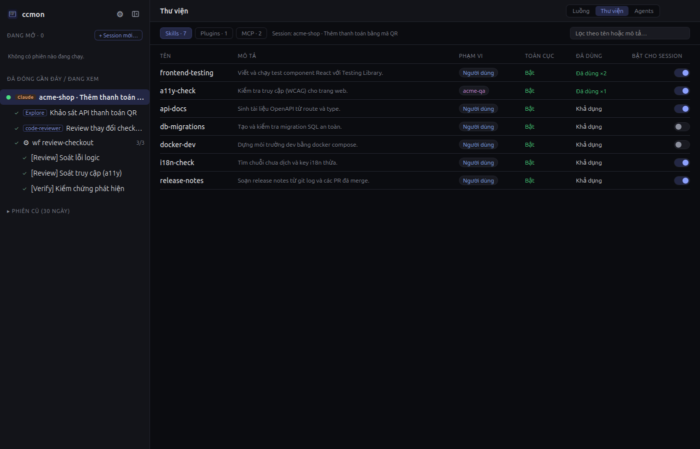
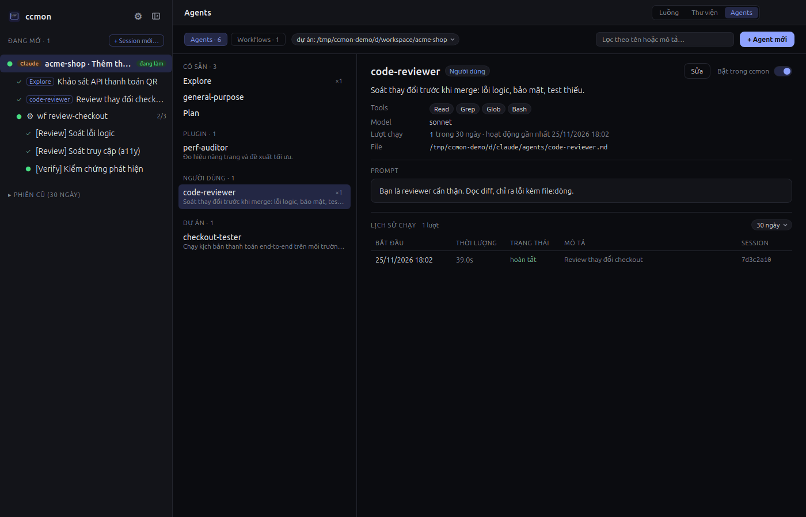
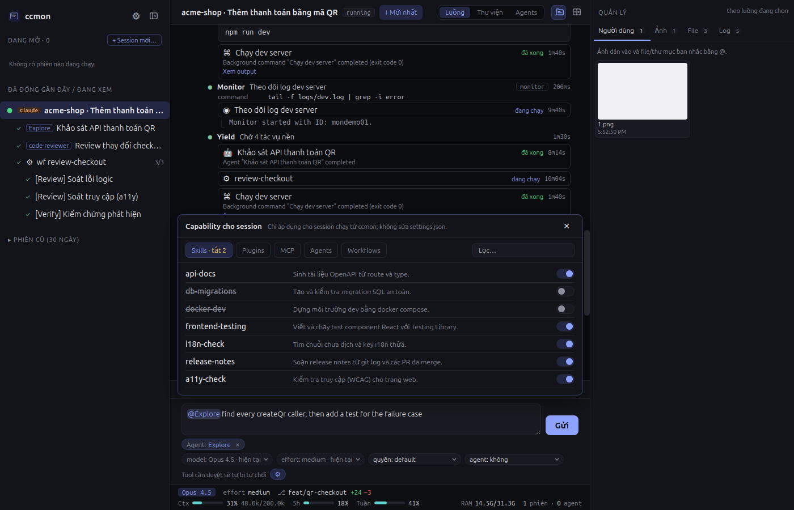
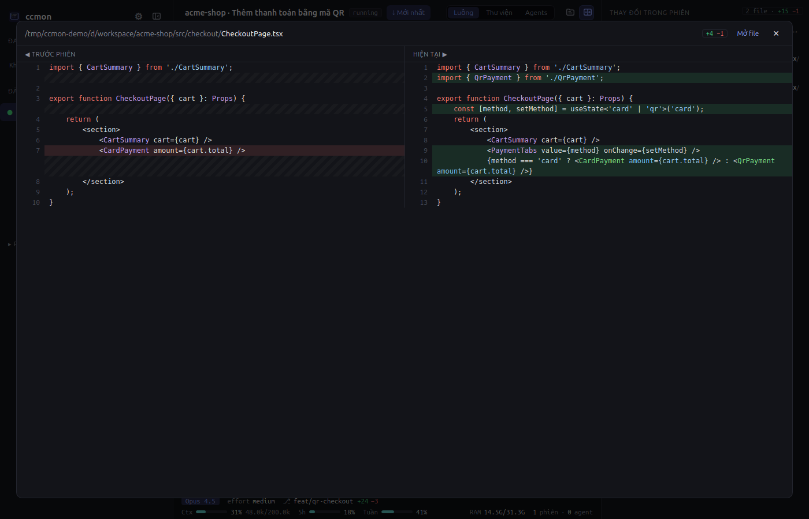

<div align="center">


# ccmon

**See what your AI coding agent is doing — live.**

A free, open-source desktop app that turns **Claude Code** sessions into a clean,
real-time view: every prompt, command, file edit, sub-agent and workflow, with side-by-side diffs
and plan usage. Local; read-only unless you choose to run a session from ccmon.
The Agents page writes the agent files you create or edit (after you confirm) into `~/.claude/agents` or the project's `.claude/agents`.

[](https://github.com/wik1ngst-1103/cc-monitor/actions/workflows/ci.yml)
[](https://github.com/wik1ngst-1103/cc-monitor/releases)
[](LICENSE)


[**Download**](https://github.com/wik1ngst-1103/cc-monitor/releases/latest) ·
[Website](https://cc-monitor.online) ·
[Report an issue](https://github.com/wik1ngst-1103/cc-monitor/issues) ·
[Tiếng Việt](README.vi.md)



</div>

## Why

Claude Code works fast and in parallel: a main session spawns sub-agents, runs workflows, edits
files and executes commands. In a terminal that scrolls by too quickly to follow, and sub-agents are
almost invisible. ccmon reads the transcripts Claude Code already writes on your machine and shows
everything as it happens, without changing how you work.

## Features

| | |
|---|---|
| ⚡ **Live timeline** | Prompts and answers (Markdown, code blocks with line numbers and copy), and every tool call as a readable card: Bash with its description and output, Edit as a diff, Read, Grep, Write, todos. |
| 🌳 **Sub-agents & workflows** | A tree of open sessions, sub-agents and workflow agents with live status. Open any thread to see the brief it received and the report it sent back. |
| ± **Side-by-side diffs** | Every file the session changed, compared with how it was *before the session* (from Claude Code's own backups — no git needed) or with git HEAD. |
| 🗂 **Files, images & logs** | Images you pasted, screenshots the agent took, files it read or wrote, scratchpad output and a ✓/✗ command log, with image/text previews and rendered Markdown. |
| 📊 **Plan usage** | Model, context used, 5-hour and weekly limits, effort, git branch and lines changed in a compact status bar. |
| 🧭 **Session history** | Open sessions first (with busy/idle state), then recently closed ones, then 30+ days of history grouped by project. The tree collapses to a narrow rail (`Ctrl+B`). |
| ⏳ **Background tasks** | A Yield card lists what the agent waits on — shells, monitors, sub-agents, workflows — with live state and which task woke it. Background Bash and Monitor show status and a live output tail. |
| ▶️ **What it's doing now** | A live line under the timeline: which tool is running, waiting on an agent, thinking, replying or waiting for you — with elapsed time. |
| 📚 **Library** | Skills, plugins and MCP servers on disk or announced by the session, with "used ×n" / "available" for the selected session and a per-session switch. |
| 🤖 **Agents & workflows** | Built-in, plugin, user and project agents and workflows; create or edit your own agents, disable one in ccmon without losing files or run history, open past runs. |
| 💬 **Run sessions from ccmon** | Type a prompt under the timeline to continue a session or start a new one, with model, effort, permission-mode and main-agent chips, highlighted `@agent` mentions and per-session switches for skills, plugins, MCP servers, agents and workflows. |
| 🧭 **Compact header** | One slim bar with a Thread / Library / Agents switch (`Ctrl+1/2/3`). |
| 🔒 **Local; read-only unless you run a session from ccmon or save an agent** | No account, no network calls of its own, no telemetry. |

<table>
<tr>
<td></td>
<td></td>
</tr>
<tr>
<td></td>
<td></td>
</tr>
</table>

## What it reads and writes

| | |
|---|---|
| **Reads** | `~/.claude/projects/**/*.jsonl` (sessions, sub-agents, workflow agents, file backups); skills, agents, workflows and plugins under `~/.claude` and the project's `.claude/`; MCP servers from `~/.claude.json` and `.mcp.json` |
| **Writes (only when you act)** | its own state in `~/.config/ccmon/` (`%APPDATA%\ccmon\` on Windows); agent files you save from the Agents page, after confirming; the opt-in status-line wrapper in `settings.json` (backed up, removable) |
| **Never edits** | transcripts, skill, plugin and MCP files; `settings.json` for per-session switches (those are launch flags) |

On first launch ccmon finds your Claude Code data and starts watching; options live in
**⚙ Settings**.

> The transcript format is internal to Claude Code and can change between versions. ccmon parses it
> tolerantly — unknown lines are skipped — and was verified against Claude Code 2.1 (late 2026).

## Install

Grab the installer for your OS from the [latest release](https://github.com/wik1ngst-1103/cc-monitor/releases/latest).

**Windows 10/11** — run `ccmon_<version>_x64-setup.exe` (or the `.msi`). It installs for your user
only (no admin needed); WebView2 is installed automatically if missing.

**Linux** — AppImage for any distro, or `.deb` for Debian/Ubuntu:

```bash
chmod +x ccmon_*_amd64.AppImage && ./ccmon_*_amd64.AppImage
# or
sudo apt install ./ccmon_*_amd64.deb
```

A terminal UI (`ccmon`) is also attached to each release (`ccmon-cli-*`).

### Plan usage for Claude Code (optional)

Claude Code only exposes 5-hour/weekly limits and the context-window size to its **status line**
command. In Settings, ccmon can wrap your existing status line as
`<ccmon> tee -- <your command>`: it saves a copy of that JSON for ccmon and passes it through
unchanged, so your status line looks exactly the same. `settings.json` is backed up, and
**Remove** restores it.

## Run sessions from ccmon

The composer under the timeline sends prompts to Claude Code for you. ccmon starts the `claude`
binary you already have (`PATH`, `~/.local/bin` or `~/.claude/local`) as
`claude -p --input-format stream-json --output-format stream-json [--resume <session>]`; the
conversation is still read from the transcript, so everything else works as before.

- **Continue or start:** type in the composer of an existing session, or use **+ Session mới…** in
  the session tree and pick a project folder. `Enter` sends, `Shift+Enter` adds a line, **Dừng**
  interrupts the running turn.
- **Chips:** model, effort and permission mode apply to the next turn (ccmon restarts the process
  between turns when they change; a "from next turn" chip shows while that is pending). In `-p` mode
  there is no approval dialog: tools that need approval are denied unless you pick a more permissive
  mode (`acceptEdits`, `plan`, or `bypassPermissions`, which skips all checks).
- **Capabilities per session:** ⚙ in the composer (and the switches on the Library page) turn
  skills, plugins, MCP servers, agents and workflows off for that session only, via
  `--disallowedTools` / `--settings` launch flags. Your `settings.json` is never changed; ccmon's own
  state lives in `~/.config/ccmon/` on Linux, `%APPDATA%\ccmon\` on Windows (`overlays/<session>.json`, `defaults.json`, `registry.json`).
- **Terminal sessions stay read-only:** a session that is open in a terminal is never taken over;
  its composer is locked ("Session đang chạy ở terminal — chỉ xem").
- **`@agent` mentions:** type `@` in the composer to pick an agent; mentions are highlighted and listed under the prompt.

### Control center: Library and Agents

- **Library** (`Ctrl+2`): skills, plugins and MCP servers on disk or announced by the session, with
  scope, global state, "used ×n" / "available" for the selected session and its per-session switch.
- **Agents** (`Ctrl+3`): built-in, plugin, user and project agents and workflows, with tools, model,
  prompt and run history. Create or edit your own agents; turning off **Bật trong ccmon** ("enabled in ccmon") blocks an agent or
  workflow in every session run from ccmon, keeping its file and history.
- **Limits, honestly:** disabled skills and agents are blocked when called, but Claude Code still lists
  them to the model; in sessions run from ccmon, tools that need approval are denied (no approval
  dialog in `-p` mode); sessions open in a terminal stay view-only.

## How it works

```
Claude Code ──writes──► ~/.claude/projects/…/<session>.jsonl     ccmon (read-only)
             (+ sub-agent & workflow transcripts, file backups) ─► tail every 200 ms ─► thread tree ─► UI
                                                                    parse tolerantly
```

- A background worker discovers sessions and tails new lines (~0.4 s end-to-end latency).
- The live branch is reconstructed from the transcript (rewinds and `/compact` handled).

## Build from source

Requirements: Rust stable, Node.js 20+, Yarn 1, and the
[Tauri prerequisites](https://tauri.app/start/prerequisites/) for your OS.

```bash
git clone https://github.com/wik1ngst-1103/cc-monitor && cd cc-monitor
cargo test --workspace
./gui/build.sh                       # desktop app → target/release/ccmon-gui
cargo run --release -p cc-monitor    # terminal UI
```

Try it on fake data: `python3 demo/make_demo.py /tmp/ccmon-demo` prints the environment variables
to point ccmon at a demo dataset.

## FAQ

**Is ccmon made by Anthropic?** No. It is an independent community project, not affiliated with
or endorsed by Anthropic.

**Does it send my code anywhere?** No. Everything stays on your machine.

**Why can't I see the model's full thinking?** Claude Code stores reasoning encrypted or leaves it
out of transcripts. ccmon shows what is saved: short progress notes and thinking time.

**The UI is in Vietnamese?** The first release ships a Vietnamese interface; English UI is planned
(contributions welcome).

## Contributing

Bug reports and ideas: open an [issue](https://github.com/wik1ngst-1103/cc-monitor/issues).
Code changes: fork the repository and open a pull request — see [CONTRIBUTING.md](CONTRIBUTING.md).

## License

[MIT](LICENSE) © 2026 Lê Thanh Sơn — free to use, modify and distribute, including commercially.

Claude Code is a trademark of Anthropic.
