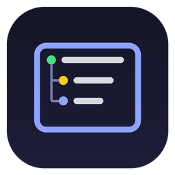
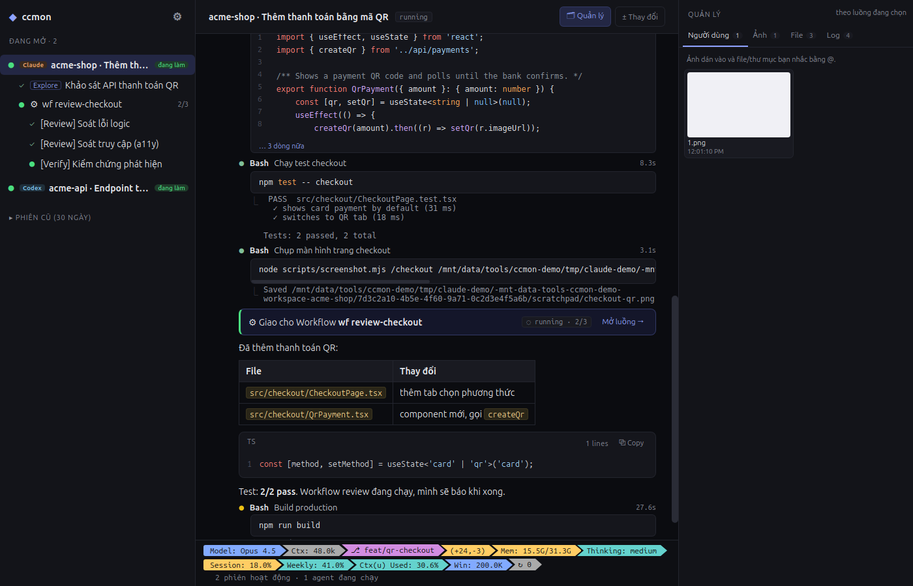

<div align="center">



# ccmon

**Xem AI coding agent đang làm gì — theo thời gian thực.**

Ứng dụng desktop miễn phí, mã nguồn mở, biến các phiên **Claude Code** và **Codex** thành một màn hình
gọn gàng, cập nhật trực tiếp: từng prompt, lệnh, file đã sửa, subagent và workflow, kèm diff hai cột
và hạn mức gói. Chạy cục bộ, chỉ đọc.

[**Tải về**](https://github.com/thanhson0514/cc-monitor/releases/latest) ·
[Website](https://thanhson0514.github.io/cc-monitor) ·
[Báo lỗi](https://github.com/thanhson0514/cc-monitor/issues) ·
[English](README.md)



</div>

## Tính năng

- **Timeline trực tiếp:** prompt, câu trả lời dạng Markdown (code block có số dòng, nút Copy), mỗi
  lần gọi tool là một thẻ dễ đọc: Bash có mô tả và output, Edit hiện diff, Read, Grep, Write, danh sách việc.
- **Subagent & workflow:** cây phiên đang mở, subagent và agent của workflow với trạng thái trực tiếp;
  mở luồng bất kỳ để xem việc được giao và báo cáo gửi về.
- **Diff hai cột:** mọi file phiên đã sửa, so với *trước phiên* (từ bản sao lưu của chính Claude Code,
  không cần git) hoặc với git HEAD.
- **File, ảnh & log:** ảnh bạn dán vào, ảnh chụp agent tạo, file đã đọc/ghi, thư mục nháp, log lệnh ✓/✗;
  xem trước ảnh/văn bản và Markdown đã định dạng.
- **Hạn mức gói:** model, context đã dùng, hạn mức 5 giờ và tuần, effort, nhánh git, số dòng thay đổi.
- **Lịch sử phiên:** phiên đang mở (đang làm/chờ), phiên vừa đóng, và các phiên cũ theo project.
- **Cục bộ & chỉ đọc:** không tài khoản, không gọi mạng, không telemetry.

## Công cụ hỗ trợ

| Công cụ | Đọc từ | Hạn mức gói |
|---|---|---|
| **Claude Code** | `~/.claude/projects/**/*.jsonl` | qua tuỳ chọn bọc status line |
| **Codex** | `~/.codex/sessions/**/rollout-*.jsonl` | có sẵn, không cần cấu hình |

Lần mở đầu tiên, ccmon tự dò công cụ đã cài và cho bạn chọn **Claude Code**, **Codex** hoặc cả hai.
Đổi lại ở **⚙ Cài đặt**.

## Cài đặt

Tải bộ cài ở [bản phát hành mới nhất](https://github.com/thanhson0514/cc-monitor/releases/latest).

- **Windows 10/11:** chạy `ccmon_<version>_x64-setup.exe` (hoặc `.msi`). Cài cho riêng tài khoản của
  bạn, không cần quyền admin; WebView2 tự cài nếu máy chưa có.
- **Linux:** AppImage chạy trên mọi bản phân phối, hoặc `.deb` cho Debian/Ubuntu:

```bash
chmod +x ccmon_*_amd64.AppImage && ./ccmon_*_amd64.AppImage
# hoặc
sudo apt install ./ccmon_*_amd64.deb
```

### Hạn mức gói của Claude Code (tuỳ chọn)

Claude Code chỉ đưa hạn mức 5 giờ/tuần và kích thước cửa sổ context cho lệnh **status line**. Trong
Cài đặt, ccmon có thể bọc status line hiện tại thành `<ccmon> tee -- <lệnh của bạn>`: lưu một bản JSON
cho ccmon rồi chuyển nguyên cho lệnh cũ, nên status line trông y như trước. `settings.json` được sao
lưu, nút **Gỡ** trả lại như cũ.

## Build từ mã nguồn

```bash
git clone https://github.com/thanhson0514/cc-monitor && cd cc-monitor
cargo test --workspace
./gui/build.sh                       # ứng dụng desktop → target/release/ccmon-gui
cargo run --release -p cc-monitor    # bản terminal
```

## Đóng góp

Báo lỗi hoặc góp ý: mở [issue](https://github.com/thanhson0514/cc-monitor/issues). Sửa code: fork repo
và mở pull request — xem [CONTRIBUTING.md](CONTRIBUTING.md).

## Giấy phép

[MIT](LICENSE) © 2026 Lê Thanh Sơn — tự do sử dụng, sửa đổi, phân phối, kể cả thương mại.

Claude Code là thương hiệu của Anthropic. Codex là thương hiệu của OpenAI. ccmon không liên kết với hai công ty.
